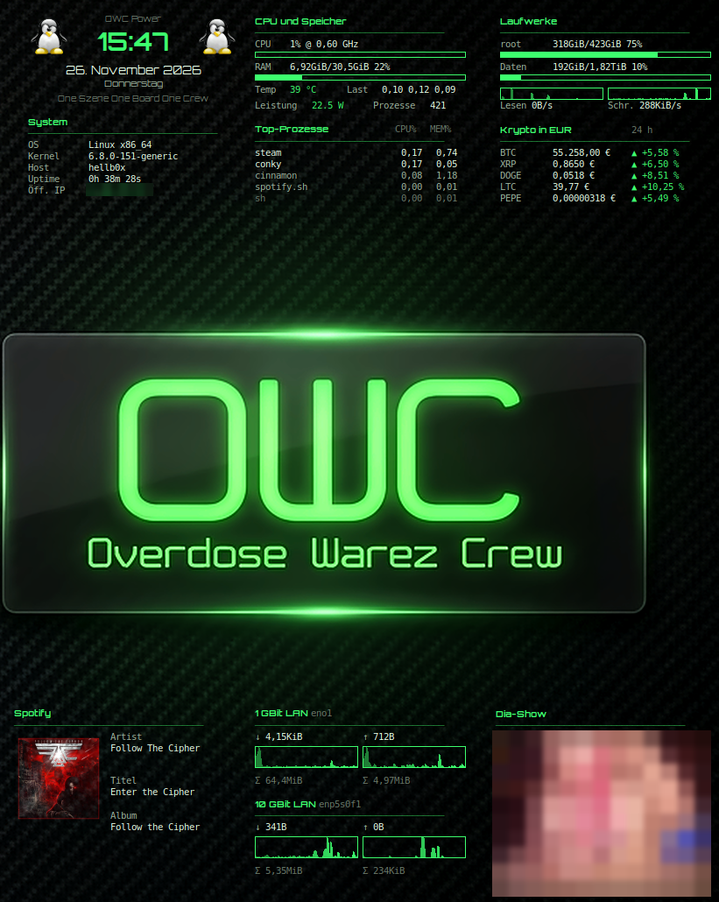

# zer0s Conky v3 – OWC Edition

Conky-Setup im Overdose-Warez-Crew-Look für einen 2560×1080-Desktop (Linux Mint / Cinnamon).
Drei Fenster rahmen das OWC-Logo des Wallpapers ein, statt es zu verdecken:



*Dia-Show und öffentliche IP sind im Screenshot unkenntlich gemacht.*

| Fenster | Datei | Inhalt |
|---|---|---|
| Uhr | `owc_clock.conf` | Uhrzeit, Datum, System, öffentliche IP |
| Oben | `owc_top.conf` | CPU, RAM, Temperatur, Last, Leistung, Top-5-Prozesse, Laufwerke, Krypto-Kurse mit 24-h-Trend |
| Unten | `owc_bottom.conf` | Spotify mit Cover, 1-GBit- und 10-GBit-LAN, Dia-Show |

Gemeinsame Farben und Schriften stehen in `owc_common.lua`.

## Voraussetzungen

```bash
sudo apt install conky-all playerctl imagemagick curl python3
```

Schriften: **Orbitron** (Überschriften, Uhr) und **DejaVu Sans Mono** (Werte, ist meist schon installiert).

```bash
mkdir -p ~/.local/share/fonts && cd ~/.local/share/fonts
wget -O Orbitron.ttf "https://github.com/google/fonts/raw/main/ofl/orbitron/Orbitron%5Bwght%5D.ttf"
fc-cache -f
```

## Installation

```bash
git clone https://github.com/zer0de-r00tSec/zer0s-Conky-v3.git
cp -r zer0s-Conky-v3/.conky/. ~/.conky/
chmod +x ~/.conky/*.sh ~/.conky/ip ~/.conky/price.py
~/.conky/start_conky.sh
```

Im Cinnamon-Autostart als Befehl `~/.conky/start_conky.sh` eintragen.

### Alte v2-Dateien entfernen

```bash
rm -f ~/.conky.conf ~/.conky_diashow.conf
```

## Anpassen

- **Position:** `gap_x` / `gap_y` oben in jeder `.conf` (gemessen vom rechten oberen Bildschirmrand).
- **Netzwerk-Interfaces:** `eno1` und `enp5s0f1` in `owc_bottom.conf`.
- **Zweites Laufwerk:** `/mnt/Daten` in `owc_top.conf`.
- **Dia-Show-Ordner:** `diashow.sh`.
- **Coins:** `COINS` in `price.py` (Kürzel → CoinGecko-ID) und die Zeilen in `owc_top.conf`.
- **Pfade:** `owc_clock.conf` nutzt `/home/zer0/.conky/logo.png` – bei anderem Benutzer anpassen.

## Skripte

| Skript | Zweck |
|---|---|
| `start_conky.sh` | beendet alte Conky-Instanzen und startet alle drei Fenster |
| `price.py` | Krypto-Kurse in EUR von CoinGecko, 6 min Cache, Fehler in `/tmp/conky_crypto.err` |
| `power_ryzen.sh` | CPU-Paketleistung über RAPL, ohne Conky zu blockieren |
| `cpu_temp.sh` | Ryzen-Temperatur (k10temp) |
| `spotify.sh` | Spotify-Metadaten und Cover (lädt nur bei Titelwechsel neu) |
| `diashow.sh` | zufälliges Bild, 240×180, im RAM (`/dev/shm`) |
| `ip` | öffentliche IP mit Timeout |
